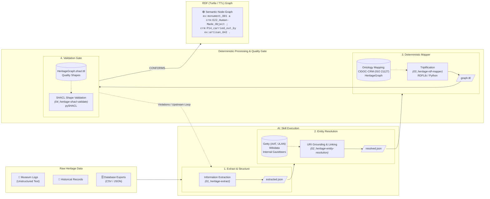

# HeritageGraph Skills (`hg-skill`)

Repository containing agent skills for transforming unstructured texts, archival records, and tabular cultural heritage data into validated, ontology-grounded RDF Turtle (`.ttl`) for contribution to the **[HeritageGraph](https://cairnepal.github.io/heritagegraphontology/)** platform by **CAIR-Nepal**.

---

## Architecture & Transformation Pipeline



---

## Core Pipeline Stages

The transformation pipeline is organized under [`skills/`](skills/):

| Stage | Skill | Description | Primary Output |
|---|---|---|---|
| **00** | [00_heritage-to-rdf](skills/00_heritage-to-rdf/SKILL.md) | End-to-end pipeline orchestrator managing stages 1 through 4. | `graph.ttl` |
| **01** | [01_heritage-extract](skills/01_heritage-extract/SKILL.md) | AI extraction from unstructured/tabular texts into schema-valid JSON. | `extracted.json` |
| **02** | [02_heritage-entity-resolution](skills/02_heritage-entity-resolution/SKILL.md) | Entity grounding and disambiguation via gazetteers, Getty, and Wikidata. | `resolved.json` |
| **03** | [03_heritage-rdf-mapper](skills/03_heritage-rdf-mapper/SKILL.md) | Deterministic triplification into RDF Turtle using declarative CIDOC-CRM mappings. | `graph.ttl` |
| **04** | [04_heritage-shacl-validate](skills/04_heritage-shacl-validate/SKILL.md) | Semantic and structural quality gate validating graphs with pySHACL against HeritageGraph shapes. | `validation-report.json` |

---

## Schemas & Ontology Versioning

* **Documentation**: [https://cairnepal.github.io/heritagegraphontology/](https://cairnepal.github.io/heritagegraphontology/)
* **LinkML Source Schema**: [`schemas/HeritageGraph.yaml`](schemas/HeritageGraph.yaml)
* **Ontology TTL**: [`schemas/HeritageGraph.ttl`](schemas/HeritageGraph.ttl)
* **SHACL Quality Shapes**: [`schemas/HeritageGraph.shacl.ttl`](schemas/HeritageGraph.shacl.ttl)
* **Upstream Sources**: [`schemas/SOURCES.md`](schemas/SOURCES.md)

### Updating Ontology Artifacts

To fetch or update ontology artifacts to a specific release tag, branch, or commit:

```bash
# Fetch latest from main (default)
python scripts/update_ontology.py

# Fetch a specific tag or branch
python scripts/update_ontology.py --ref v1.0.1
```

---

## Quick Start: End-to-End Execution

Once stages 1 and 2 produce `resolved.json`, run the deterministic mapping and validation pipeline:

```bash
python skills/00_heritage-to-rdf/scripts/run_pipeline.py resolved.json
```
