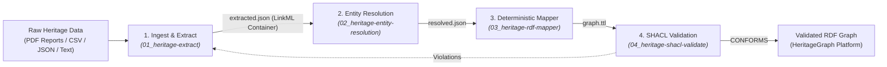

# Heritage to RDF Pipeline

Orchestrate the end-to-end transformation of cultural heritage data into a validated Turtle (`.ttl`) graph conforming to the CAIR-Nepal Cultural Heritage Ontology.

## Architecture



## Supported Inputs
- Multi-page PDF survey reports & books (with OCR text normalization & page chunking)
- Tabular spreadsheets (CSV, TSV, XLSX)
- Museum and archival catalog dumps (JSON)
- Unstructured field notes, transcripts, and inscriptions

## Pipeline Steps

### 1. Ingestion & Configuration
- Prompt user for raw data path (local filesystem path or downloadable URL).
- Confirm the target ontology and version (default: `cidoc-crm`).
- **Always work on copies** in a working scratch directory; never mutate user originals.

### 2. Extract & Structure
- Follow [01_heritage-extract](../01_heritage-extract/SKILL.md).
- Output: `extracted.json`.
- **Completion Gate**: Run `python ../01_heritage-extract/scripts/validate_extraction.py extracted.json`. Do not proceed until validation passes.

### 3. Entity Resolution
- Follow [02_heritage-entity-resolution](../02_heritage-entity-resolution/SKILL.md).
- Output: `resolved.json`.
- **Completion Gate**: Each record must carry a URI, confidence score, and source. If no confident match exists, mint a local URI (never hallucinate a foreign link).

### 4. Deterministic RDF Mapping
- Follow [03_heritage-rdf-mapper](../03_heritage-rdf-mapper/SKILL.md).
- Run:
  ```bash
  python ../03_heritage-rdf-mapper/scripts/map_to_rdf.py resolved.json --ontology <ontology> --out graph.ttl
  ```
- **Completion Gate**: `graph.ttl` is generated with valid RDF syntax.

### 5. SHACL Quality Gate
- Follow [04_heritage-shacl-validate](../04_heritage-shacl-validate/SKILL.md).
- Run:
  ```bash
  python ../04_heritage-shacl-validate/scripts/validate.py graph.ttl --ontology <ontology>
  ```
- **Completion Gate**: If validation fails, report violations plainly (record + constraint) and remediate upstream in stage 2 or 3. Never edit shapes to force a pass.

*(Note: Once Stages 1 and 2 are complete, Stages 4 and 5 can also be run sequentially via `python scripts/run_pipeline.py resolved.json`)*.

## Deliverables
Report `graph.ttl` with:
1. Total record count and triple count.
2. Resolution breakdown: linked URIs vs. minted local URIs.
3. SHACL validation status.
4. List of any dropped records or unresolved entities requiring human review.
