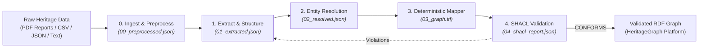

# Heritage to RDF Pipeline

Orchestrate the end-to-end transformation of cultural heritage data into a validated Turtle (`.ttl`) graph conforming to the CAIR-Nepal Cultural Heritage Ontology.

## Architecture



All pipeline artifacts are scoped within an isolated run workspace: `runs/<run_id>/` (e.g., `runs/2026-10-25_idjmss-patan/`), accompanied by an authoritative provenance envelope (`manifest.json`).

## Supported Inputs
- Multi-page PDF survey reports & books (with OCR text normalization & page chunking)
- Tabular spreadsheets (CSV, TSV, XLSX)
- Museum and archival catalog dumps (JSON)
- Unstructured field notes, transcripts, and inscriptions

## Pipeline Steps & Stage Artifacts

### 1. Ingestion & Preprocessing (Stage 0)
- Ingest raw document:
  ```bash
  python skills/01_heritage-extract/scripts/ingest_raw.py <input-path> [--run-dir runs/<run_id>]
  ```
- Output: `00_preprocessed.json` and initialized `manifest.json`.

### 2. Extract & Structure (Stage 1)
- Follow [01_heritage-extract](../01_heritage-extract/SKILL.md).
- Output: `01_extracted.json`.
- **Completion Gate**: Run `python skills/01_heritage-extract/scripts/validate_extraction.py --run-dir runs/<run_id>`. Do not proceed until validation passes.

### 3. Entity Resolution (Stage 2)
- Follow [02_heritage-entity-resolution](../02_heritage-entity-resolution/SKILL.md).
- Run:
  ```bash
  python skills/02_heritage-entity-resolution/scripts/resolve_entities.py --run-dir runs/<run_id>
  ```
- Output: `02_resolved.json`.
- **Completion Gate**: Each record must carry a URI, confidence score, and source. If no confident match exists, mint a local URI (never hallucinate a foreign link).

### 4. Deterministic RDF Mapping (Stage 3)
- Follow [03_heritage-rdf-mapper](../03_heritage-rdf-mapper/SKILL.md).
- Run:
  ```bash
  python skills/03_heritage-rdf-mapper/scripts/map_to_rdf.py --run-dir runs/<run_id> [--mapping <file>]
  ```
- Output: `03_graph.ttl`, typed natively with `heritageGraph:` classes (default mapping `heritagegraph`, generated from the LinkML schema; `--mapping assets/mappings/cidoc-crm.yaml` or `run_pipeline.py --ontology cidoc-crm` for the CRM alternate).
- **Completion Gate**: Valid RDF syntax verified; mapping name, schema version and triple count recorded in `manifest.json`.

### 5. SHACL Quality Gate (Stage 4)
- Follow [04_heritage-shacl-validate](../04_heritage-shacl-validate/SKILL.md).
- Run:
  ```bash
  python skills/04_heritage-shacl-validate/scripts/validate.py --run-dir runs/<run_id>
  ```
- Output: `04_shacl_report.json`.
- **Completion Gate**: If validation fails, report violations plainly (record + constraint) and remediate upstream. Never edit shapes to force a pass.

*(Note: Once Stage 1 extraction is serialized, Stages 2 through 4 can be orchestrated in one command via `python skills/00_heritage-to-rdf/scripts/run_pipeline.py --run-dir runs/<run_id>`)*.

## Deliverables
Report `graph.ttl` with:
1. Total record count and triple count.
2. Resolution breakdown: linked URIs vs. minted local URIs.
3. SHACL validation status.
4. List of any dropped records or unresolved entities requiring human review.
